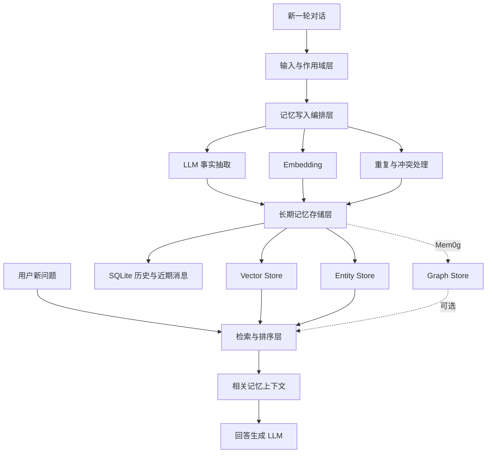
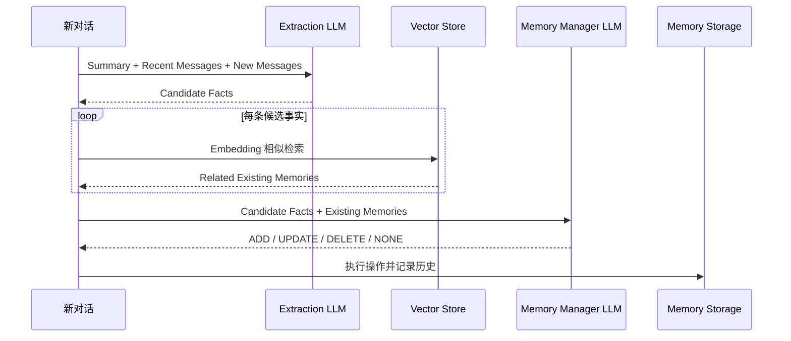
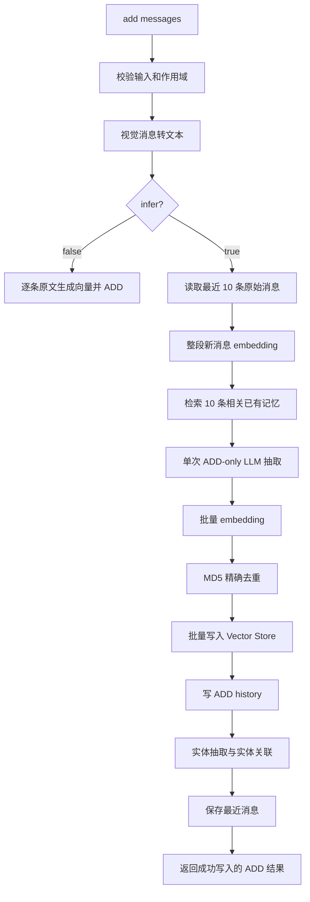
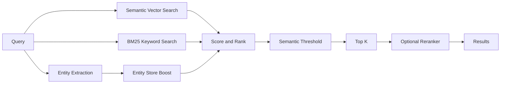

# Mem0 长期记忆系统总架构

> 文档日期：2026-10-08  
> 分析范围：Mem0 论文思想、经典 Mem0 流程、当前 OSS Python SDK、Mem0g 图记忆扩展  
> 当前源码基线：`c780b64f281b780d31b950ee849843330a74f891`

## 1. 文档目的

Mem0 的核心任务不是保存完整聊天记录，而是把对话转化为可持续维护、可按需召回的长期记忆。它需要回答三个问题：

1. **记什么**：从新对话中提取未来可能有用的事实、偏好、计划和经历。
2. **怎么维护**：处理重复、补充、变化、冲突、删除和作用域隔离。
3. **怎么使用**：面对新问题时，只召回相关记忆并交给生成模型，而不是重新加载全部历史。

本文统一描述四个容易混淆的对象：

- **论文/经典 Mem0**：两阶段的 Extraction + Update 架构。
- **当前 OSS V3**：以 ADD-only 抽取和混合检索为主的实现。
- **Mem0g**：在事实记忆之外增加图结构的扩展方案。
- **源码知识图谱**：Understand Anything 对代码结构的可视化，不是运行时用户记忆。

## 2. 总体分层



从职责上看，系统可以划分为五层：

| 层 | 主要职责 |
|---|---|
| 输入与作用域层 | 规范化消息，处理 `user_id`、`agent_id`、`run_id` 和 metadata |
| 写入编排层 | 抽取事实、查找相关旧记忆、去重、决定并执行持久化操作 |
| 存储与索引层 | 保存有效记忆、变更历史、近期消息和实体关联 |
| 检索与排序层 | 语义召回、BM25、实体增强、阈值过滤和可选 rerank |
| 回答生成层 | 将召回结果与当前问题组合，交给应用侧 LLM 生成答案 |

Mem0 主要解决长期记忆管理。长时间运行 Agent 的任务进度、工具结果、检查点和依赖关系属于更高一层的**任务状态管理**，不能只依赖 Mem0 事实记忆。

## 3. 论文与经典 Mem0：两阶段记忆写入

经典架构把记忆写入拆成 Extraction 和 Update 两次 LLM 判断。



### 3.1 Extraction phase

论文中的候选事实抽取可以表示为：

\[
F = \phi_{\mathrm{LLM}}(S, H_{\mathrm{recent}}, M_{\mathrm{new}})
\]

其中：

- \(S\)：异步生成的历史摘要。
- \(H_{\mathrm{recent}}\)：近期消息窗口，论文实验设置 `m=10`。
- \(M_{\mathrm{new}}\)：当前新增对话。
- \(F\)：候选事实集合。

LLM 决定“哪些内容值得成为候选记忆”。Embedding 不负责重要性判断，它负责在下一阶段查找语义相近的旧记忆。

### 3.2 相似旧记忆检索

对候选事实生成 embedding，并在相同用户、Agent 或运行作用域内检索相似旧记忆。论文实验中的相似记忆数量为 `s=10`。

需要区分三个层次：

| 机制 | 判断的问题 |
|---|---|
| 精确 hash | 文本是否字面完全一致 |
| Embedding | 两条事实在语义上是否接近 |
| LLM Memory Manager | 两条事实是重复、补充、变化还是冲突 |

### 3.3 Update phase

Memory Manager LLM 比较候选事实和相关旧记忆，输出四种操作：

| 操作 | 语义 | 执行行为 |
|---|---|---|
| `ADD` | 出现独立的新事实 | 新建 ID、生成向量、插入存储 |
| `UPDATE` | 同一事实发生变化或新表述更完整 | 保留原 ID，替换文本与向量 |
| `DELETE` | 新信息明确否定旧事实，或收到删除指令 | 删除有效记忆并记录删除历史 |
| `NONE` / `NOOP` | 内容已存在或无须改变 | 不修改记忆内容 |

这里的“Agent”本质上是一个受结构化 Prompt 约束的 LLM 决策器，不是独立的自治 Agent 框架。

### 3.4 异步摘要

论文明确异步运行的是 Summary Generator：它周期性压缩较早的历史，为未来 Extraction 提供全局背景。论文没有指定必须使用 Kafka、RabbitMQ 或 Redis Stream；消息队列和 Worker 属于可选的生产工程实现。

## 4. 当前 OSS V3：ADD-only 写入流水线

当前仓库在提交 `a488e190` 后用 V3 additive pipeline 替换了经典的自动四操作流程。核心实现位于：

- `mem0/memory/main.py`：`Memory`、`AsyncMemory` 和完整生命周期编排。
- `mem0/configs/prompts.py`：V3 抽取 Prompt 与旧版兼容 Prompt。
- `mem0/memory/storage.py`：SQLite 历史和近期消息。
- `mem0/utils/scoring.py`：混合检索评分。
- `mem0/utils/entity_extraction.py`：实体抽取和实体增强。

### 4.1 组件装配

`Memory` 和 `AsyncMemory` 通过 Factory 创建以下组件：

```text
Memory / AsyncMemory
├── LLM
├── Embedder
├── Vector Store
├── SQLiteManager
├── optional Reranker
└── lazy Entity Store
```

Vector Store 是当前有效记忆的主要事实来源；SQLite 主要保存变更历史和最近对话，不替代向量库。

### 4.2 当前写入时序



### 4.3 “10 + 10”的准确含义

当前运行时有两个不同的 10：

1. **Existing Memories = 10**：把整段新消息作为一个查询，在向量库中获取最相关的 10 条长期记忆，用于去重上下文。
2. **Last k Messages = 10**：从 SQLite 读取当前 session 最近 10 条原始对话，用于代词解析和局部语境。

它们不是同一类数据。Prompt 中虽然还有 `Summary` 和 `Recently Extracted Memories` 区段，但当前 `Memory.add()` 没有传入这两项，因此它们在 OSS V3 调用中为空。

### 4.4 当前操作语义

V3 系统 Prompt 明确规定：`Your sole operation is ADD`。因此：

| 场景 | 当前行为 |
|---|---|
| 新事实 | 返回并持久化 `ADD` |
| 完全相同的事实 | LLM 跳过，或由 MD5 再次过滤 |
| 语义相同但表述不同 | 主要依赖 LLM 根据 Existing Memories 跳过 |
| 事实发生变化 | 作为新的、上下文丰富的事件追加，而非自动覆盖旧事实 |
| 自动 UPDATE | 当前 `add()` 不执行 |
| 自动 DELETE | 当前 `add()` 不执行 |
| NOOP | LLM 返回空数组，`add()` 返回空结果 |

旧版 `DEFAULT_UPDATE_MEMORY_PROMPT` 和 `get_update_memory_messages()` 仍留在代码中，但当前主写入链路不调用它们。

### 4.5 显式更新和删除

当前更新必须调用 `Memory.update()`：

```text
读取原记忆
→ 保留不可变作用域字段
→ 合并可变 metadata
→ 重新生成 embedding、hash、BM25 文本
→ vector_store.update
→ 写 UPDATE history
→ 清理旧实体关联并从新文本重新建立关联
```

当前删除必须调用 `Memory.delete()`：

```text
读取原记忆
→ vector_store.delete
→ 写 DELETE history
→ 从 Entity Store 清理 memory_id
```

`delete_all()` 按作用域分批删除，避免向量库默认分页造成漏删；`reset()` 才用于清空整个实例。

### 4.6 LLM linking 与实体关联的区别

V3 Prompt 要求 LLM 可返回 `linked_memory_ids`，但当前持久化代码没有消费这个字段。因此现在没有根据该字段建立通用的“记忆到记忆”边。

当前真正落库的是 Entity Store：系统从记忆文本中抽取实体，以独立向量集合保存实体，并在 payload 中维护 `linked_memory_ids`，形成：

```text
实体 → [memory_id_1, memory_id_2, ...]
```

这是一种用于搜索增强的实体倒排关联，不等于 Neo4j 式通用知识图谱。

## 5. 检索架构

系统里存在两种不同目的的 retrieval。

### 5.1 写入时 retrieval

用途：为 LLM 提供可能重复或相关的旧记忆，帮助决定是否抽取新事实。

```text
整段新消息
→ query embedding
→ scoped vector search(top_k=10)
→ Existing Memories
→ ADD-only extraction prompt
```

当前 V3 不再针对每条候选 fact 单独搜索，而是在抽取之前对整段新消息做一次粗粒度召回。

### 5.2 回答前 retrieval

对外 `search()` 使用混合检索：



处理步骤：

1. 校验 query、`top_k`、`threshold` 和作用域 filters。
2. 对 query 做词形归一化和实体抽取。
3. 生成 query embedding。
4. 语义检索超额候选：`internal_limit = max(top_k × 4, 60)`。
5. 如果后端支持，执行 BM25 keyword search。
6. 在 Entity Store 中查找相关实体并为其关联记忆加分。
7. 先用语义 `threshold` 淘汰低分候选。
8. 融合分数、排序并截取 `top_k`。
9. 可选执行 Reranker。

当前融合公式是：

\[
score = \frac{semantic + normalized\_bm25 + entity\_boost}{max\_possible}
\]

其中实体增强最大权重为 `0.5`。BM25 和实体结果只给语义候选加分，不会单独向最终候选池增加一条语义检索完全未命中的记忆。

## 6. 输入、作用域与数据模型

### 6.1 身份作用域

Mem0 使用以下字段隔离记忆：

- `user_id`：用户级长期记忆。
- `agent_id`：Agent 级记忆或 Agent 视角知识。
- `run_id`：单次任务或运行级记忆。

写入时这些值通过顶层参数传入；搜索和 `get_all()` 要求放在 `filters` 中。自由 metadata 不能修改身份字段，避免把记忆移动到未授权的作用域。

### 6.2 主要记忆 payload

一条有效记忆通常包含：

```json
{
  "id": "uuid",
  "data": "User prefers oat milk",
  "hash": "md5-of-data",
  "text_lemmatized": "user prefer oat milk",
  "user_id": "u1",
  "agent_id": "optional",
  "run_id": "optional",
  "attributed_to": "user",
  "created_at": "ISO-8601",
  "updated_at": "ISO-8601",
  "expiration_date": "optional",
  "...custom_metadata": "..."
}
```

### 6.3 存储职责

| 存储 | 内容 | 作用 |
|---|---|---|
| Vector Store | 有效记忆文本、向量和 metadata | 主检索和当前状态 |
| SQLite history | ADD/UPDATE/DELETE 记录 | 审计和历史查询 |
| SQLite messages | 每个 session 最近 10 条原始消息 | 下一轮抽取的近期上下文 |
| Entity Store | 实体向量和关联 memory IDs | 实体增强检索 |
| Graph Store | 图节点和关系 | Mem0g 或独立图记忆能力，不是当前主链默认组件 |

## 7. 输出契约

### 7.1 `add()`

当前 V3 只返回成功写入向量库的记录：

```json
{
  "results": [
    {
      "id": "uuid",
      "memory": "User prefers oat milk",
      "event": "ADD"
    }
  ]
}
```

如果没有值得新增的内容，返回：

```json
{"results": []}
```

### 7.2 `search()`

```json
{
  "results": [
    {
      "id": "uuid",
      "memory": "User prefers oat milk",
      "hash": "...",
      "created_at": "...",
      "updated_at": "...",
      "score": 0.83,
      "user_id": "u1",
      "metadata": {}
    }
  ]
}
```

当 `explain=True` 时，每条结果还会包含 `semantic_score`、`bm25_score`、`entity_boost`、`raw_score`、归一化分母、最终分数和阈值。

## 8. Mem0g 图记忆扩展

Mem0g 与基础 Mem0 不是同一个存储模型。它使用知识图谱表达：

\[
G=(V,E,L)
\]

- \(V\)：实体节点。
- \(E\)：关系边。
- \(L\)：实体类型标签。

例如：

```text
张三 ──就读于──> 某大学
张三 ──喜欢──> 机器学习
```

Mem0g 的主要流程包括实体抽取、关系三元组生成、冲突检测、图更新和图检索。常见检索路径包括：

1. **Entity-Centric Retrieval**：从查询实体出发寻找邻居和相关子图。
2. **Semantic Triplet Retrieval**：对关系三元组执行语义相似度检索。

图结构适合多跳关系和时间关系推理，但会增加抽取、图更新、冲突处理和查询规划成本。它不是所有问答类型上的必然升级。

## 9. 论文、经典实现与当前代码差异

| 维度 | 论文/经典设计 | 历史 OSS 实现 | 当前 OSS V3 |
|---|---|---|---|
| 写入 LLM 次数 | Extraction + Update 两阶段 | 两次 LLM | 一次 ADD-only LLM |
| 近期消息 | `m=10` | 依版本而异 | SQLite 最近 10 条 |
| 相似旧记忆 | `s=10` | 曾使用每条 fact `top_k=5` | 整段消息一次 `top_k=10` |
| 自动操作 | ADD/UPDATE/DELETE/NOOP | 实际执行四操作 | 只自动 ADD |
| 更新/删除 | LLM 决策后执行 | `_update_memory` / `_delete_memory` | 显式调用公开 API |
| 精确去重 | 论文未明确为核心模块 | 依版本而异 | MD5 hash 去重 |
| 检索 | 主要描述 embedding | 向量检索，可选图检索 | 语义 + BM25 + Entity boost + Reranker |
| Summary | 异步 Summary Generator | 部分版本支持 | Prompt 有区段，但当前调用未传 summary |
| 图关系 | Mem0g 扩展 | 曾有独立 graph 集成 | 主链使用 Entity Store，不是通用 Graph Store |

因此，讨论 Mem0 时必须注明是在说论文算法、旧版 OSS、当前 OSS V3，还是 Mem0g；否则最容易在“四操作是否仍存在”和“10 条到底是什么”上产生误解。

## 10. 一致性、降级与失败处理

当前实现包含一些面向生产的降级策略：

- 批量 embedding 失败时回退到逐条 embedding。
- 批量向量写入失败时回退到逐条插入。
- 只有真正写入 Vector Store 的记录才进入 history、实体关联和 API 成功结果。
- Entity Store 失败通常记录 warning，但不破坏主要记忆写入。
- LLM 调用失败会抛出明确错误，使上层能够重试或切换 provider。
- LLM 返回空内容或无法解析时，通常视为没有抽取结果。

仍需由应用侧考虑：

- LLM 写入的幂等键和任务重试策略。
- Vector Store、SQLite、Entity Store 之间不存在跨存储事务时的最终一致性。
- 多 Worker 并发更新同一用户记忆时的锁、版本号或乐观并发控制。
- 记忆保留期限、过期清理和隐私删除。
- 重要性评分、记忆预算和长期衰减策略。

## 11. 用于长任务 Agent 时的补充架构

Mem0 事实记忆不能完整替代任务状态。建议将长任务系统拆成三种数据：

| 类型 | 示例 | 推荐存储 |
|---|---|---|
| 语义记忆 | 用户偏好、稳定事实、历史经验 | Mem0 |
| 情节记忆 | 某次任务发生过什么、关键结果 | Mem0 或事件日志 |
| 任务状态 | 已完成步骤、未完成依赖、工具输出、重试次数 | 工作流数据库/检查点系统 |

推荐流程：

```text
Agent 执行事件
├── 写任务状态和检查点（强一致）
├── 写原始事件日志（可审计）
└── 异步提取长期记忆（最终一致）
```

这样即使上下文被压缩或模型会话被重启，Agent 仍然知道“已经做了什么、产出了什么、接下来做什么”。

## 12. 源码导航

| 主题 | 文件/位置 |
|---|---|
| 同步 Memory 入口 | `mem0/memory/main.py:487` |
| `add()` | `mem0/memory/main.py:760` |
| V3 ADD pipeline | `mem0/memory/main.py:881` |
| `search()` | `mem0/memory/main.py:1393` |
| 混合检索 | `mem0/memory/main.py:1642` |
| `update()` | `mem0/memory/main.py:1829` |
| `delete()` | `mem0/memory/main.py:1883` |
| 异步 Memory | `mem0/memory/main.py:2193` |
| V3 additive prompt | `mem0/configs/prompts.py:468` |
| 旧四操作 prompt | `mem0/configs/prompts.py:176` |
| 旧 Update prompt builder | `mem0/configs/prompts.py:406` |
| SQLite history/messages | `mem0/memory/storage.py` |
| 混合评分 | `mem0/utils/scoring.py` |
| 实体抽取 | `mem0/utils/entity_extraction.py` |

查看被 V3 替换前的经典四操作执行器：

```bash
git show 'a488e190^:mem0/memory/main.py'
```

## 13. 核心结论

Mem0 的核心价值不是压缩率本身，而是建立一条稳定的闭环：

```text
从对话中提取有价值信息
→ 以正确作用域持久化
→ 面对新问题时准确召回
→ 将召回内容转化为更连续、更个性化的回答
```

论文/经典 Mem0 依赖第二个 LLM 做四操作管理；当前 OSS V3 改为 ADD-only 事件追加，通过近期消息、相关旧记忆、MD5 去重、实体增强和显式更新 API 来完成维护。Mem0g 则进一步引入图结构，适合关系密集和多跳推理场景。三者解决的问题相关，但运行模型和工程边界并不相同。
